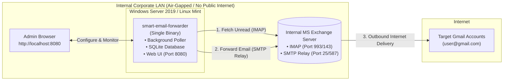

# Smart Email Forwarder

A minimal, reliable, cross-platform email forwarder written in Rust. It monitors an **Internal MS Exchange** mailbox (via IMAP), lists and deduplicates new incoming emails, and forwards them to designated **Gmail accounts** via the **Internal Exchange SMTP Relay**.

The application is specifically engineered for **offline / air-gapped** enterprise environments such as **Windows Server 2019 Standard** (with no internet access) and **Linux Mint**.

---

## Key Highlights

- **100% Offline Ready (Zero External Dependencies)**:
  - Compiles into a **single standalone binary** (`.exe` on Windows, ELF on Linux).
  - The Web UI (HTML, CSS, JavaScript) is embedded directly into the executable at compile time (`include_str!`).
  - SQLite is compiled directly into the binary (`rusqlite(bundled)`). Zero external DLLs or SQL server needed.
  - No internet connection, no Node.js runtime, no Python runtime, and no npm/pip needed on the server.
- **Enterprise Network Friendly**:
  - The server hosting the app only communicates on the local LAN with the **Internal Exchange Server** (both for IMAP mailbox reading and SMTP outbound relaying).
  - The Exchange Server handles public internet delivery to Gmail.
  - Supports self-signed / internal corporate SSL certificates.
- **Full Email Fidelity**:
  - Preserves plain text, rich HTML, and all file attachments (PDFs, images, office docs).
  - Preserves the original sender in the `Reply-To` header so replying in Gmail works naturally.
  - Injects a clear forwarding header banner.
  - Tracks processed message IDs in SQLite to prevent duplicate forwarding across restarts.
- **Unattended Background Service**:
  - **Windows Server 2019**: Runs as a native Windows Service that starts automatically on system boot (before user login) and automatically recovers on failure.
  - **Linux Mint**: Runs as a standard `systemd` daemon.
- **Minimal Responsive Web UI**:
  - Dashboard with live status, sync stats, and activity table.
  - Instant connection test buttons for Exchange IMAP and SMTP relay.
  - Immediate "Sync Now" button and poller pause/resume.
  - Real-time event log viewer.

---

## Architecture Overview



---

## Quick Start & Local Run

### 1. Build the Binary
```bash
# Debug build
cargo build

# Optimized release build
cargo build --release
```

### 2. Run in Console Mode
```bash
# Starts the server on port 8080
./target/release/smart-email-forwarder --port 8080
```
Open your browser to `http://localhost:8080`.

---

## Deployment on Windows Server 2019 (Offline / No Internet)

Because Windows Server 2019 has no internet access, deployment is as simple as copying one file:

### Step 1: Copy Executable
1. Build `smart-email-forwarder.exe` on a build workstation (`cargo build --release`).
2. Copy `smart-email-forwarder.exe` and the `deploy/windows/` folder to the Windows Server (e.g. `C:\SmartEmailForwarder\`).

### Step 2: Install as an Automatic Windows Service
Open Command Prompt **as Administrator** and run:
```cmd
cd C:\SmartEmailForwarder
deploy\windows\install_service.bat
```
This registers the service via Windows' built-in `sc.exe`, sets it to auto-start on boot, configures automatic crash recovery (restarts within 5 seconds), and starts it immediately.

### Alternative Manual `sc.exe` Commands:
```cmd
# Create Service
sc.exe create "SmartEmailForwarder" binPath= "C:\SmartEmailForwarder\smart-email-forwarder.exe --service" start= auto DisplayName= "Smart Email Forwarder"

# Configure Auto-Recovery
sc.exe failure "SmartEmailForwarder" reset= 86400 actions= restart/5000/restart/5000/restart/5000

# Start Service
sc.exe start "SmartEmailForwarder"

# Stop Service
sc.exe stop "SmartEmailForwarder"

# Delete Service
sc.exe delete "SmartEmailForwarder"
```

Access the Web UI from any workstation on the network: `http://<server-ip>:8080`.

---

## Deployment on Linux Mint

### Step 1: Install Binary & Service File
```bash
sudo mkdir -p /opt/smart-email-forwarder
sudo cp target/release/smart-email-forwarder /opt/smart-email-forwarder/
sudo chmod +x /opt/smart-email-forwarder/smart-email-forwarder

# Copy systemd unit file
sudo cp deploy/linux/email-forwarder.service /etc/systemd/system/
sudo systemctl daemon-reload
```

### Step 2: Enable & Start Service
```bash
# Start and enable on boot
sudo systemctl enable --now email-forwarder.service

# Check status
sudo systemctl status email-forwarder.service

# View live logs
journalctl -u email-forwarder.service -f
```

---

## Configuration via Web UI (`http://localhost:8080`)

The application provides a clean single-page interface with 5 tabs:

1. **Dashboard**:
   - Current status (Active / Paused / Syncing).
   - Counters for Total Forwarded and Failed Deliveries.
   - Next poll countdown timer and "Sync Now" button.
   - Live activity table showing recent forwarded emails with details modal.

2. **Exchange Mailbox Settings**:
   - **Host / IP**: FQDN or IP of the Exchange Server (e.g. `mail.company.local`).
   - **Port**: `993` (SSL/TLS) or `143` (STARTTLS / Plain).
   - **Encryption**: `SSL/TLS`, `STARTTLS`, or `Plain`.
   - **Username**: Domain account or email (e.g. `domain\user` or `user@company.local`).
   - **Password**: Stored securely in SQLite (masked as `••••••••` in UI).
   - **Folder**: Mailbox folder to monitor (default: `INBOX`).
   - **Mark as Read**: Toggle to flag forwarded emails as `\Seen` in Exchange.
   - **Accept Internal/Self-Signed SSL**: Toggle if your Exchange uses an internal CA certificate.
   - **Test Exchange Connection**: Validates login and folder access with one click.

3. **Forwarding Rules**:
   - **Destination Gmail Addresses**: One or multiple comma/newline-separated Gmail addresses.
   - **Subject Prefix**: Optional tag like `[Exchange-Fwd] `.
   - **Polling Interval**: In minutes (default: 1 min).
   - **Include Forwarding Header Banner**: Injects metadata box at top of body.
   - **Preserve Reply-To**: Sets original sender as `Reply-To`.

4. **Exchange SMTP Relay Settings**:
   - **Relay Host**: Internal Exchange Server host or IP (e.g. `mail.company.local`).
   - **Port**: `25` (standard unauthenticated internal relay), `587` (STARTTLS), or `465` (SSL).
   - **From Email & Name**: Authorized sender address (e.g. `forwarder@company.com`).
   - **Authentication**: Checkbox for credentials if relay requires authentication.
   - **Send Test Email**: Relays a verification email to test delivery to Gmail.

5. **Activity Logs**:
   - Real-time diagnostic stream of polling cycles, successful deliveries, and error details.

---

## Automated Tests

Run the full test suite offline:
```bash
cargo test
```
Tests cover:
- RFC822 MIME parsing and body extraction.
- PDF and binary attachment extraction and integrity.
- SQLite deduplication and settings persistence with password masking.
- Axum web server routes and embedded offline asset delivery.
